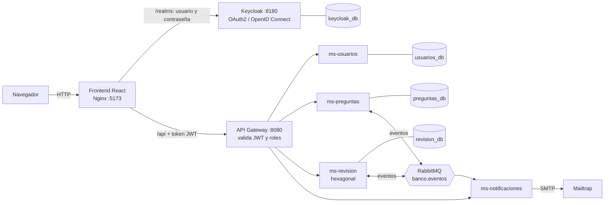

# Banco de Preguntas Saber Pro

Sistema web para **crear, validar, revisar por pares y aprobar preguntas** de selección múltiple que preparan a los estudiantes para las pruebas Saber Pro. Está construido con **microservicios orientados a eventos**, **seguridad con Keycloak (OAuth2 / JWT)**, **arquitectura hexagonal** y se despliega completo con **Docker Compose**.

> Proyecto de curso de Ingeniería de Software II, Universidad del Cauca, 2026.2.
> Equipo: Cristian Camilo Ramirez Camacho · Juliana Andrea Salas Tapia · Victor Manuel Ortiz Rojas

       

## Qué hace

| Historia | Rol | Funcionalidad |
|---|---|---|
| HU-1 | Autor | Crear preguntas con contexto, enunciado, 5 opciones, justificación, bibliografía, competencia, tema, subtema y dificultad, con **validación estructural** |
| HU-2 | Autor | Enviar a revisión: *Borrador* → *Pendiente de revisión* (estados con colores) |
| HU-3 | Autor | Listar sus preguntas con **filtros y paginación**, ver y editar |
| HU-4 | Administrador | Asignar **de 1 a 3 revisores**; se notifica por correo |
| HU-5 | Revisor | Evaluar (aprobar o rechazar con observaciones); se decide por política (unanimidad o mayoría) y se notifica a todos |
| HU-6 | Autor | Ver el **historial de revisiones por versión** y enviar una **versión mejorada**; se notifica a los implicados |

## Arquitectura



| Componente | Contexto delimitado | Responsabilidad |
|---|---|---|
| **api-gateway** | — | Punto único de entrada. Valida el token JWT, autoriza por rol, reenvía el usuario autenticado y unifica Swagger |
| **ms-usuarios** | Gestión de Usuarios | Perfiles (nombre, correo, roles) y directorio de revisores |
| **ms-preguntas** | Gestión de Preguntas | Crear, editar, listar, validar, ciclo de vida (patrón State) y versiones |
| **ms-revision** | Revisión por Pares | Bandeja del administrador, asignación, evaluación, decisión e historial. **Arquitectura hexagonal** |
| **ms-notificaciones** | Notificaciones | Escucha eventos y envía correos (Mailtrap o consola) |
| **Keycloak** | Identidad | Usuarios, contraseñas, roles y emisión de tokens JWT |

Cada microservicio tiene **su propia base de datos** (patrón *Database per service*) en PostgreSQL, con los datos en un **volumen de Docker**.

### Eventos (RabbitMQ, exchange topic `banco.eventos`)

| Evento | Routing key | Publica | Consume |
|---|---|---|---|
| PreguntaEnviadaARevision | `pregunta.enviada-revision` | ms-preguntas | ms-revision |
| RevisoresAsignados | `revision.revisores-asignados` | ms-revision | ms-preguntas, ms-notificaciones |
| PreguntaEvaluada | `revision.pregunta-evaluada` | ms-revision | ms-preguntas, ms-notificaciones |
| NuevaVersionRecibida (HU-6) | `revision.nueva-version` | ms-revision | ms-notificaciones |

### Seguridad (Keycloak + JWT)

1. El usuario inicia sesión en el frontend; Keycloak valida la contraseña y entrega un **token JWT** firmado (RS256) con sus roles en `realm_access.roles`.
2. Cada petición lleva `Authorization: Bearer <token>`. El **API Gateway** (Spring Security, OAuth2 Resource Server) verifica la firma con las llaves públicas de Keycloak y la vigencia del token.
3. El gateway **autoriza por rol**: solo un AUTOR crea y envía preguntas, solo el ADMINISTRADOR asigna revisores, solo un REVISOR evalúa. Sin token responde **401**; con un rol que no corresponde, **403**.
4. El gateway borra cualquier encabezado `X-Usuario` que venga del cliente y lo vuelve a poner con el usuario del token. Así nadie puede hacerse pasar por otro.
5. En Docker, los microservicios **no publican puertos**: solo se llega a ellos a través del gateway.

### Arquitectura hexagonal (ms-revision)

```
ms-revision/src/main/java/.../revision
├── domain/                     Núcleo: entidades, objetos de valor, políticas y eventos. Java puro.
│   ├── model/                  PreguntaPendiente (raíz del agregado), Revision, RondaRevision
│   ├── politica/               IPoliticaDecision: Unanimidad / Mayoría (Strategy + Factory Method)
│   └── evento/                 Eventos de dominio
├── aplicacion/
│   ├── puerto/entrada/         Casos de uso: IAsignarRevisoresUseCase, IEvaluarPreguntaUseCase,
│   │                           IConsultarHistorialUseCase, IRegistrarPreguntaEnviadaUseCase
│   ├── puerto/salida/          Lo que el núcleo necesita: repositorios, directorio de usuarios, publicador
│   └── servicio/               Implementación de los casos de uso
└── infraestructura/
    ├── entrada/rest/           Adaptador REST (controlador y DTOs)
    ├── entrada/mensajeria/     Adaptador RabbitMQ que recibe eventos
    ├── salida/persistencia/    Adaptadores JPA
    ├── salida/mensajeria/      Publicador RabbitMQ
    ├── salida/cliente/         Cliente REST de ms-usuarios
    └── config/                 Composition root (Spring)
```

Las dependencias apuntan hacia adentro: el dominio y la aplicación no conocen Spring, JPA ni RabbitMQ, por eso se prueban con JUnit puro y un adaptador se puede cambiar sin tocar las reglas de negocio.

## Patrones de diseño GoF

| Tipo | Patrón | Dónde |
|---|---|---|
| Creacional | **Builder** | `Pregunta.Builder` (ms-preguntas) |
| Creacional | **Factory Method** | `ValidadorFactory` (ms-preguntas), `PoliticaDecisionFactory` (ms-revision) |
| Creacional | **Singleton** | Estados de la pregunta (`EstadoBorrador.getInstancia()`, …) |
| Estructural | **Adapter** | `*RepositorioJpaAdapter`, `UsuariosRestClient`, `ServicioEmailSmtp` |
| Estructural | **Composite** | `ValidadorEstructural` (reglas) y `FiltroCompuestoY` (filtros) |
| Estructural | **Facade** | `NotificacionFacade` (ms-notificaciones) |
| Comportamiento | **State** | Ciclo de vida: Borrador, Pendiente, En revisión, Aprobada, Rechazada |
| Comportamiento | **Strategy** | Reglas de validación, filtros, `IPoliticaDecision` |
| Comportamiento | **Observer** | Publicadores y `@RabbitListener` |
| Comportamiento | **Template Method** | `PlantillaNotificacion` y sus subclases |

## Cómo ejecutarlo

### Opción A: todo en Docker (recomendada)

Requisitos: **Docker Desktop** con al menos **4 GB de memoria** asignados.

```bash
docker compose up -d --build
```

La primera vez tarda varios minutos (descarga imágenes y compila con Maven dentro de Docker). Luego abra:

| Qué | URL | Acceso |
|---|---|---|
| Aplicación | http://localhost:5173 | usuarios de prueba (contraseña `1234`) |
| Swagger de todos los servicios | http://localhost:8080/swagger-ui.html | botón *Authorize* con un token |
| Consola de Keycloak | http://localhost:8180 | admin / admin |
| Consola de RabbitMQ | http://localhost:15672 | guest / guest |

Correos reales (opcional): copie `ms-notificaciones/correo.env.example` como `ms-notificaciones/correo.env` con sus credenciales de Mailtrap. Sin ese archivo los correos se muestran en el log de `banco-ms-notificaciones`.

Comandos útiles:

```bash
docker compose ps                    # estado de los contenedores
docker compose logs -f api-gateway   # ver el log de un servicio
docker compose down                  # detener (los datos quedan en los volúmenes)
docker compose down -v               # detener y BORRAR los datos
docker volume ls                     # banco-pgdata y banco-rabbitdata
```

### Opción B: modo desarrollo

Requisitos: Java 17+, Maven 3.9+, Node 18+ y Docker Desktop.

1. `iniciar-backend.bat` (Windows) o `./iniciar-backend.sh`: levanta RabbitMQ, PostgreSQL y Keycloak en Docker y los 5 procesos Java (usan H2).
2. `cd frontend && npm install && npm run dev` y abra http://localhost:5173.

### Usuarios de prueba (Keycloak)

| Usuario | Rol | Contraseña |
|---|---|---|
| autor1 | Autor | 1234 |
| autor2 | Autor y Revisor | 1234 |
| revisor1 … revisor4 | Revisor | 1234 |
| admin | Administrador | 1234 |

### Postman

`postman/Banco-Preguntas-Tercer-Corte.postman_collection.json` incluye:

1. Obtener tokens JWT de cada rol.
2. Pruebas de seguridad (401 sin token, 403 con un rol sin permiso).
3. **Gestión de usuarios y roles** con la API de administración de Keycloak (crear usuario, asignar rol) y registro del perfil en ms-usuarios.
4. El flujo completo HU-1 a HU-6 a través del gateway.

## Pruebas

```bash
mvn test
```

Pruebas unitarias JUnit 5 de las entidades y servicios del dominio de cada microservicio, sin Spring ni base de datos (con dobles en memoria), más las pruebas de lectura de roles del token en el gateway.

## Estructura del repositorio

```
banco-preguntas-ms/
├── api-gateway/          Spring Cloud Gateway + Spring Security (JWT)
├── ms-usuarios/          Spring Boot · JPA
├── ms-preguntas/         Spring Boot · JPA · RabbitMQ
├── ms-revision/          Spring Boot · JPA · RabbitMQ · arquitectura hexagonal
├── ms-notificaciones/    Spring Boot · RabbitMQ · Mail
├── frontend/             React 18 + Vite · Nginx en Docker
├── infra/                Script de bases de datos y realm de Keycloak
├── postman/              Colección de Postman
└── docker-compose.yml    Despliegue completo con volúmenes
```
